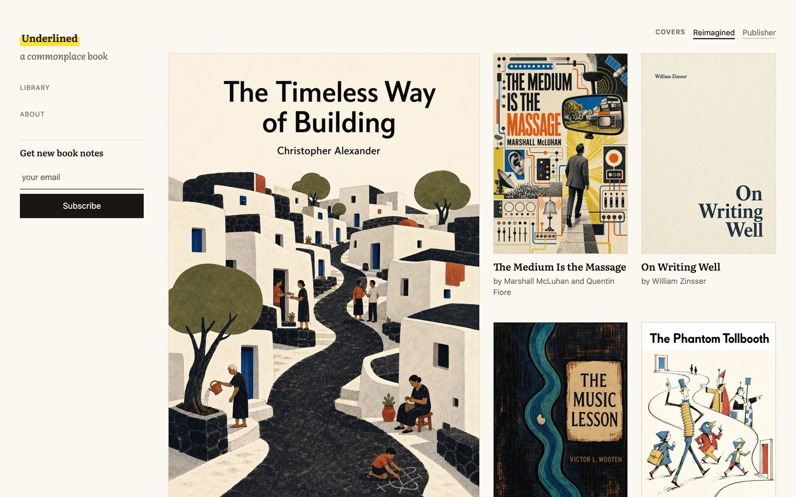
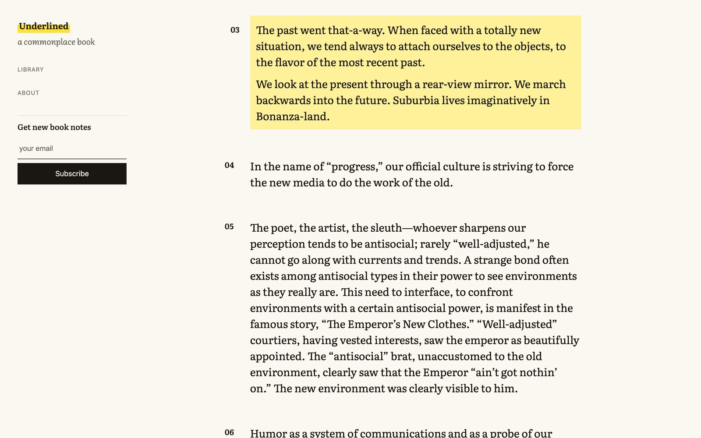
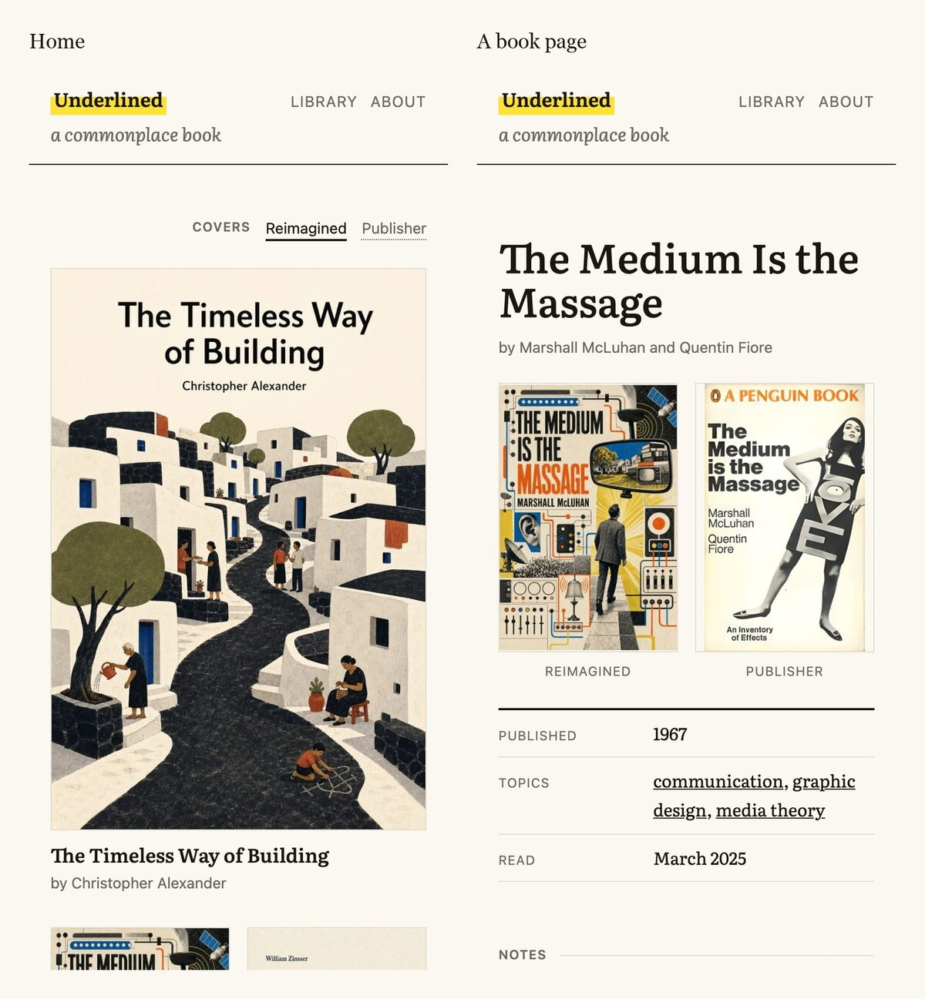
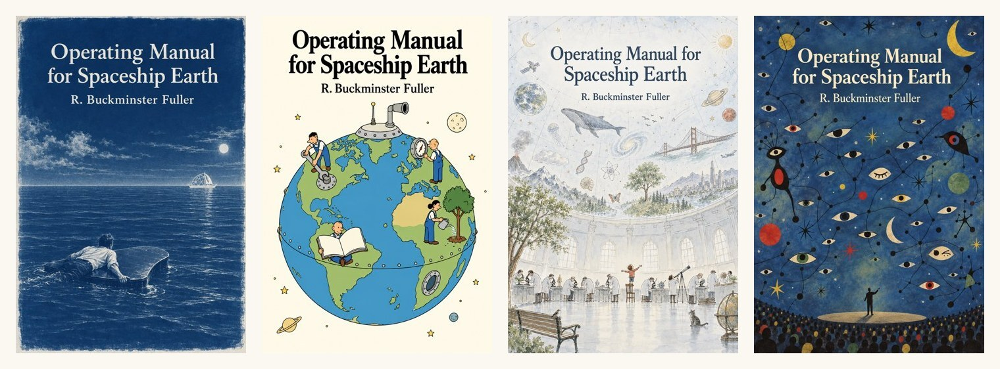
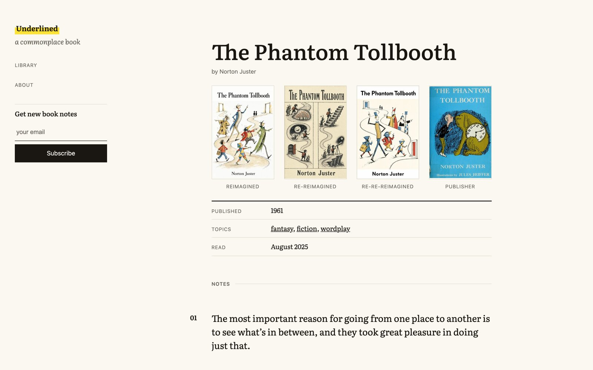

As a child, I dreamed of designing book covers. Years ago I [designed a few](/routing-in-stochastic-networks/), and then life moved on. All the while, I kept copying passages out of the books I read, first into notebooks and later into [Day One](https://dayoneapp.com/) on my phone, and sending my favorites to family and friends.

This year the two habits finally met. [Underlined](https://underlined.fgelbal.com) is a public home for those passages: one page per book, with my notes, a cover I reimagined, and the publisher’s cover beside it.

## There’s an old word for this

While I was looking for a domain for the project, I learned that this habit already has a name: a *commonplace book*. The name comes from the Latin *locus communis*, a heading under which readers filed passages worth keeping. Renaissance students were taught to keep one.

## One page per book

Each book gets a single page, marked with the month I read it. The passages appear in the order I read them, numbered, and each has its own link, so I can send a friend one passage instead of a whole book. These pages aren’t reviews. If a passage is here, it’s because I stopped reading to write it down.

The covers sit at the top of each page: mine first, then the publisher’s. On the homepage, one switch turns every reimagined cover into the publisher’s and back.

## Reimagining a cover

Every reimagined cover starts from my notes: what stayed with me, what surprised me, and the version of the book that formed in my imagination. For *The Medium Is the Massage*, that was McLuhan’s line about looking at the present through a rear-view mirror. On my cover, a man walks into a world of wires and dials while a mirror above him shows the suburbs.

I turn those fragments into a few ideas per book and write a prompt for each. Then I try every idea in different print styles: woodcuts, cyanotypes, Swiss posters, Ottoman miniatures, ebru marbling. Text-to-image models make this part fast. I can send the same prompt to three or four models at once and explore many paths in parallel, for a few cents a render. One cover alone took well over a hundred renders.

I go through every render in a custom app I built for myself, marking each one a favorite, a finalist, or a discard, and I refine the favorites over several rounds. Most of the time goes into details:

* The title and author appear on every cover, spelled exactly, in one solid typeface. After building [Dottıng](/do-not-dot-the-pixel-i/), I don’t trust a model’s lettering until I’ve read it letter by letter.
* One idea, staged once, with calm space for the title.
* Motifs come from the book and from my impression of it.

Sometimes I can’t choose. Then a book keeps more than one cover, and the labels admit it: Reimagined, Re-reimagined, Re-re-reimagined.

## From Day One to WordPress.com

The passages live in Day One, and many were scanned from the page with my phone, so a few come with scanning typos. I fix those in Day One first, which keeps the journal the source of truth. With Claude, I wrote a script that exports the journal through Day One’s MCP server (a connector that lets AI tools read it) and turns each entry into a book page.

I built the site itself in [WordPress Studio](https://developer.wordpress.com/studio/), a free app for running WordPress sites on your own computer. As with Dottıng, I described what I wanted in plain English, and AI coding agents, mostly Claude Code, did the work through Studio’s command-line tool: a custom theme for the covers and passages, and a small plugin for the book pages. When the site was ready, Studio pushed it to WordPress.com. It’s hosted there now with subscriptions turned on, so every new book also goes out by email.

## Come read with me

Each email brings one passage I underlined, with a link to the rest of the book. You can subscribe at [underlined.fgelbal.com](https://underlined.fgelbal.com), follow along by [RSS](https://underlined.fgelbal.com/feed/), or find it in the WordPress.com Reader.

I’d love your feedback on the site and the covers, the reimagined ones especially. And if a passage catches your eye, tell me which one.

I’m an amateur cover designer, so I’ll end with a McLuhan line from my notes: “The amateur can afford to lose.”
